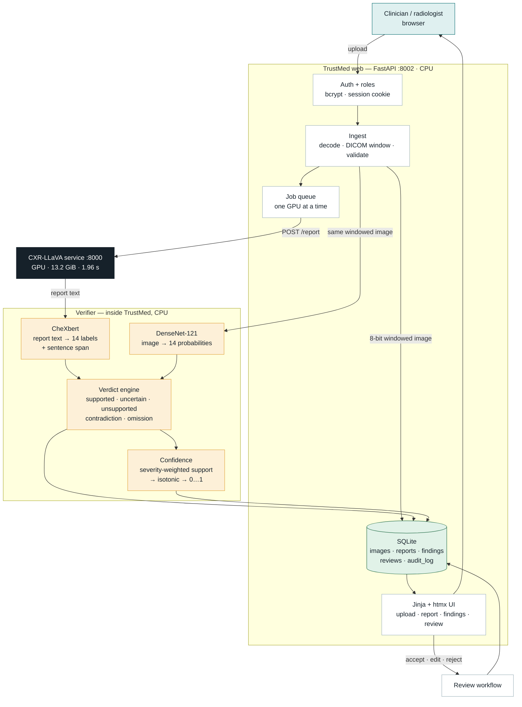
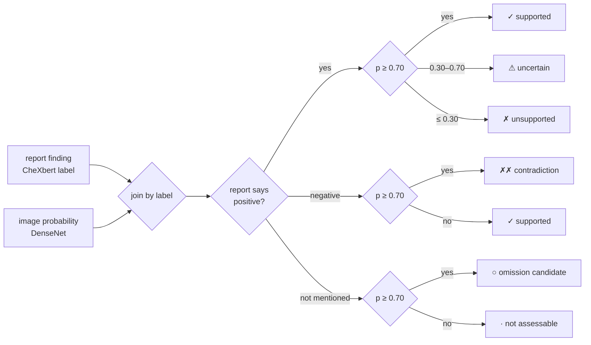
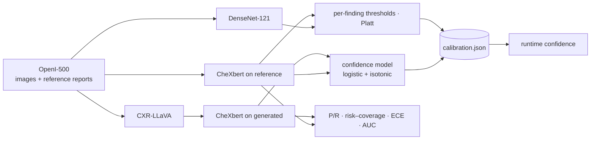

# TrustMed — components and flow

v1 scope: **CXR-LLaVA generates · CheXbert extracts · DenseNet-121 verifies · calibrated confidence · human review.**
UI design language taken from `trustmed_prototype .zip`; nothing else from it.

## 1. Runtime flow (one report)

## 2. Verdict engine (the core rule)

## 3. Offline calibration + evaluation (run once, before demo)

## 4. Component responsibilities

| Component | Does | Does not |
|---|---|---|
| Ingest | decode, window, invert MONOCHROME1, validate, hash | generate anything |
| Generator client | call `/report`, record model + prompt hash + seed | interpret the text |
| CheXbert | report → labels + which sentence | see the image |
| DenseNet-121 | image → 14 probabilities | read the report |
| Verdict engine | join the two, emit 5 verdicts + severity | learn anything |
| Confidence | verdicts → calibrated 0…1 | invent features |
| Review | store human decision, immutable | change the report |
| UI | show *why*, not just *what* | decide |

## 5. From the zip — UI only

**Taken:** the palette (`--paper/--teal/--ok/--warn`), dark header + warning notice, left rail (upload · threshold · pipeline with `ms` tags), dual viewer with film captions, score bar with threshold tick, highlighted report sentences, findings bar list, focus rings, reduced-motion handling.

**Not taken:** template report bank, DenseNet-as-generator, seeded simulation, `Verified` wording, 10 MB/JPEG-only limits.
